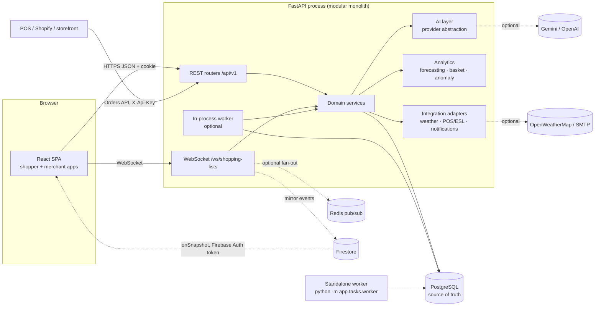

# OmniPulse AI — Architecture & Decisions

This document records the architectural shape of OmniPulse AI and the reasoning behind major
choices. Implementation details (modules, endpoints, tables, commands) live in
[TECHNICAL_README.md](TECHNICAL_README.md). Individual decision records are in
[docs/decisions/](docs/decisions/).

## 1. Shape: a modular monolith

On Google Cloud (the live demo) the SPA is served by **Firebase Hosting**, which rewrites `/api` to
the API container on **Cloud Run**; **Firestore** with **Firebase Auth** custom tokens carries
real-time updates; **Gemini** is the AI provider (see §10).

* **One deployable backend** with strict internal module boundaries: `api` (HTTP/WebSocket only),
  `services` (business rules & transactions), `ai`, `analytics` (pure algorithms, no DB),
  `integrations` (adapters to the outside world), `tasks` (queue/worker/scheduler), `db` (models).
  Microservices were rejected: one team, one data model, strong transactional coupling between
  inventory, pricing and expiry; splitting would add network failure modes without benefit.
* **The same image runs the API and the worker.** Scale them independently (API replicas behind a
  load balancer; N worker processes).

## 2. Data

* **PostgreSQL is the source of truth** for everything, including collaborative list state and the
  list event log. Redis is optional and used only for ephemeral coordination (WebSocket fan-out
  between API instances, shared rate-limit counters).
* **Normalised relational schema** (63 tables). The CSV import format is mapped onto products,
  inventory items, batches, placements and categories — it is *not* the storage format.
* **All stock lives in batches.** `inventory_items.quantity_on_hand` is always recomputed as the sum
  of its batches, and every change writes a `stock_adjustments` ledger row. This makes expiry,
  FEFO consumption and audit trivially consistent.
* **Tenant isolation**: every merchant-owned row carries `merchant_id` (directly or via its store);
  every merchant query is filtered by the authenticated `MerchantContext`, and foreign IDs return
  404 (no existence leak). Store-scoped staff (`all_stores = false`) are further restricted to their
  stores.
* **Portable types**: UUID primary keys, timezone-aware UTC timestamps (`UTCDateTime`), `Numeric(12,2)`
  money, JSON columns only for genuinely schemaless data (evidence, settings, payload snapshots).
  The schema runs on PostgreSQL (primary) and SQLite (zero-setup development and fast tests).

## 3. Business logic boundaries

| Concern | Decision |
|---|---|
| Pricing | Recommendation generation (expiry rules, weather opportunities) is separate from publication. Every price change follows `RECOMMENDED → PENDING_APPROVAL → APPROVED → PUBLISHED` (+ REJECTED/CANCELLED/EXPIRED/FAILED). Guardrails (price floor, max markdown, tier caps, no automatic increases, no personal attributes) are pure functions in `pricing_policy.py`, re-checked at approval and at publication. Auto-publication only when the merchant enabled it, within a configured %. |
| Expiry | Hourly re-evaluation is idempotent (dedupe keys per batch+severity). Expired batches are withdrawn and written off — never offered for sale. |
| Fraud | Deterministic rules and statistical anomaly scores are computed and shown separately. Output is a review queue; humans record outcomes. No automatic accusations, bans or rejected returns. |
| Merchandising | Recommendations are framed as experiments with evidence, evidence quality, an A/B plan and observational outcome tracking — never promised uplift. Safety rules (heavy items, refrigeration, children's products) are hard constraints. |
| AI | LLMs only interpret language and phrase answers. They never touch the database; services execute validated, permission-checked operations and replies are validated against verified facts. |

## 4. AI architecture

`AIProvider` (interface) → `DemoProvider` (deterministic rules + hashed lexical embeddings),
`OpenAIProvider`, `GeminiProvider` (shared `LLMProvider` base with JSON-schema validation and
per-call fallback to the demo provider). Selection via `AI_PROVIDER`; missing keys fall back to demo.
Search is hybrid lexical + embedding cosine similarity. Embeddings are stored with provider/model/
dimension/content-hash, so a model change triggers re-embedding. See [ADR-0004](docs/decisions/0004-ai-provider-abstraction.md).

The smallest suitable technique is used everywhere: Dijkstra + Held-Karp for routing, pair-wise
Apriori for affinity, Ridge regression vs a seasonal-naive baseline (selected by backtest) for
demand, IsolationForest for anomalies, explicit heuristics (with stated assumptions) for markdowns.

## 5. Real-time collaboration

Every list mutation (REST or WebSocket) goes through `shopping_service.apply_operation`, which
checks the member's role, applies optimistic versioning (`expected_version` → 409 with the current
item), appends an event with a monotonically increasing per-list `seq`, and commits. The hub then
delivers the event to connected members (and through Redis to other API instances). Clients resync
after reconnecting with `?last_seq=N`; operations carry a `client_event_id` so retries are
idempotent. Check-off is conflict-free (setting the same state twice is a no-op). See
[ADR-0005](docs/decisions/0005-realtime-lists.md).

On Firebase Hosting, which cannot proxy WebSockets, the same hub messages are mirrored to Firestore
(one ordered writer thread, Admin SDK). Browsers sign in to Firebase with a custom token minted by
the API and listen with `onSnapshot`; security rules allow reads only to list members (and, for the
merchant live feed, to that merchant's staff). PostgreSQL/SQLite stays the source of truth and the
only place business writes happen; Firestore is a delivery layer the app can run without.

## 6. Background work

A durable queue in `job_runs` (status, attempts, exponential-backoff retries, dedupe keys) with a
worker that claims jobs via conditional UPDATE (safe with multiple workers on PostgreSQL). A
scheduler enqueues periodic jobs (expiry re-evaluation, forecast refresh, stockout risk, promotion
lifecycle, analytics refresh, fraud scan, embedding re-index) with time-bucketed dedupe keys. Celery
was not adopted because it requires a broker that is unnecessary at this scale; the queue interface
(`enqueue`) would allow swapping later. See [ADR-0002](docs/decisions/0002-db-backed-job-queue.md).

## 7. Security model

* httpOnly, SameSite=Lax session cookie carrying a short-lived JWT bound to a server-side
  `auth_sessions` row (logout = revocation). Bearer tokens are accepted for API clients.
* Role-based permissions (`roles`, `permissions`, `role_permissions`) per merchant membership;
  every merchant endpoint declares its required permission; store scoping for store staff.
* Argon2 password hashing, login/registration/assistant rate limits, upload size/type checks,
  Pillow decompression-bomb guard, CSV row limits, strict CORS, safe error envelopes, audit log for
  security- and business-relevant actions, invitation tokens stored hashed with expiry/revocation/
  use limits, secrets only from environment variables (integration settings reject secret-like keys).

### Omnichannel ingestion
Every sale, whatever the channel (a POS bill through the Orders API, a Shopify `orders/create`
webhook, a click & collect order from the shopper app, or the POS simulator), goes through one service
function, `channel_service.ingest_order`. It is idempotent on the external order id, consumes batches
first-expiry-first-out through the stock ledger, rejects online orders that would oversell, raises
low-stock alerts, and publishes the order to the merchant's live feed. Connectors authenticate with
per-merchant API keys stored as SHA-256 hashes.

## 8. Frontend

React + TypeScript SPA with two route trees and layouts (`/shop/*` shopper, `/merchant/*` store
team), TanStack Query for server state, shared UI kit (shadcn-style components on Radix primitives
and Tailwind design tokens), a reusable SVG `StoreMap` (routes, highlights, drag-and-drop
planogram editing), a reconnecting `ListSocket` and a Firestore channel with the same contract
(chosen at runtime from `GET /realtime/config`). Vite proxies `/api` and `/media` to the API in
development; nginx does the same in the container image, and Firebase Hosting rewrites them to Cloud
Run in the cloud deployment.

## 9. Deviations from the original brief (and why)

| Brief | Implementation | Reason |
|---|---|---|
| Celery for background jobs | DB-backed queue + worker + scheduler | No broker needed; identical behaviour on PostgreSQL/SQLite; documented swap path. |
| Prophet forecasting | scikit-learn Ridge with weather/calendar features + seasonal-naive baseline, chosen per product by backtest | Prophet has no wheels for the target Python (3.14) and is heavy; Ridge is explainable and adequate for daily retail series at this scale. |
| pgvector for semantic search | Embeddings stored portably (JSON) and scored in NumPy; migration 0002 adds a `vector(256)` column + HNSW index when pgvector exists | Works on SQLite and Postgres without the extension; pgvector column is ready for catalog growth. |
| shadcn/ui CLI | Hand-written shadcn-style components on Radix + Tailwind tokens | Same design approach without the interactive CLI; components live in `src/components/ui`. |
| `omnipulse-ai/` folder | Repository root is the project root | The workspace itself is the repository. |

## 10. Google Cloud deployment

| Service | Role |
|---|---|
| Cloud Run | Runs the backend container; at most one instance for the demo (in-container SQLite seeded on start), scale to zero with a free Cloud Scheduler keep-warm ping |
| Firebase Hosting | Serves the SPA; `/api`, `/media`, `/health` rewritten to Cloud Run (same origin, `__session` cookie) |
| Firestore + Firebase Auth | Real-time shared lists, presence and the merchant live feed; custom tokens and `firestore.rules` scope every read |
| Gemini | Intent extraction, grounded replies, list parsing, embeddings, vision captions, AI brief; 12 s timeout and a 60 s cooldown fall back to the deterministic provider |
| Secret Manager | JWT secret and Gemini API key |

The deploy script (`scripts/deploy-gcp.sh`) and [docs/deployment/GCP.md](docs/deployment/GCP.md) describe
every step. For a production tenant: Cloud SQL (PostgreSQL + pgvector), several Cloud Run instances
(Firestore already fans out real-time events across instances), a separate worker service, and
`SEED_ON_STARTUP=false`, `DEMO_LOGIN_ENABLED=false`.
